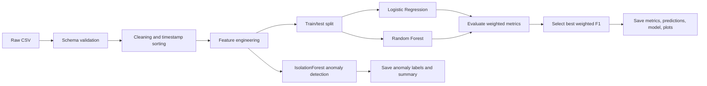
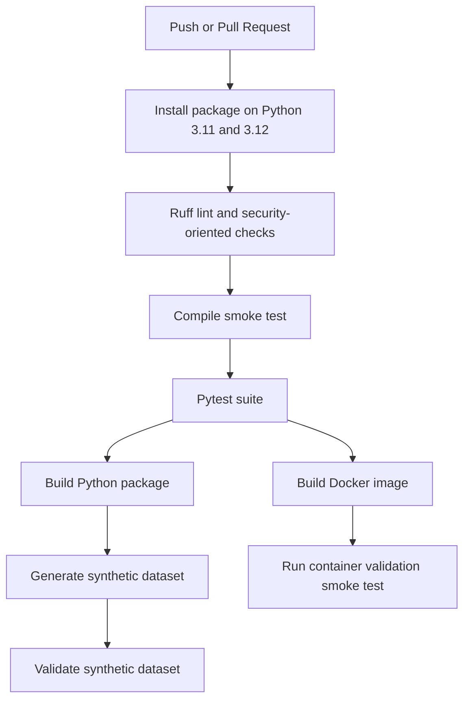

# Modeling Notes

This document explains the modeling choices behind the environmental telemetry risk pipeline. It is written for two audiences: reviewers who want to see the reasoning behind the implementation, and maintainers who want a compact study guide before discussing the project.

## Problem Framing

The project has two related goals:

- supervised risk classification: predict the discrete target `risk_level`
- unsupervised anomaly detection: flag unusual telemetry rows without requiring anomaly labels

Each dataset row is a timestamped observation:

```text
x_i = telemetry features observed at time i
y_i = risk_level for row i
```

The supervised learning task is:

```text
Given training examples {(x_1, y_1), ..., (x_n, y_n)}, learn a function f(x) that predicts y.
```

In this project, `y` is the `risk_level` column. The `failure_risk` column is deliberately excluded from features because it can behave like a downstream label or close proxy. Including it would introduce target leakage: the model would see information at training time that would not be safely available in a real deployment.

## Pipeline View



The important review point is that validation happens before modeling. This prevents invalid data from reaching later steps where failures would be harder to interpret.

## Data Validation Theory

The validator enforces a contract:

```text
dataset columns must include REQUIRED_COLUMNS
numeric telemetry columns must be coercible to numbers
timestamp must be parseable as datetime
target must contain at least two classes
```

This is a basic form of input boundary control. In data systems, model quality depends on the assumption that training and inference inputs follow the same schema. If the schema changes silently, the model can still run but produce meaningless predictions.

For a reviewer, the validation layer demonstrates:

- fail-fast behavior
- explicit assumptions
- protection against malformed inputs
- predictable CLI errors

## Feature Engineering

The raw telemetry columns are transformed into additional signals. These are intentionally simple and auditable.

| Feature | Formula | Intuition |
| --- | --- | --- |
| `humidity_temp_index` | `humidity_pct * temperature_c / 100` | combined humidity and heat stress |
| `rain_humidity_score` | `rainfall_mm + humidity_pct / 10` | moisture burden from rain and ambient humidity |
| `environment_stress_score` | `(humidity_pct + pollution_proxy + salinity_proxy) / 3` | average environmental stress proxy |
| `pressure_deviation` | `abs(pressure_hpa - 1013)` | distance from nominal sea-level pressure |
| `vibration_exposure_index` | `vibration_mm_s * log1p(exposure_hours)` | vibration amplified by duration of exposure |
| `high_humidity_flag` | `1 if humidity_pct >= 85 else 0` | threshold-based risk signal |
| `high_salinity_flag` | `1 if salinity_proxy >= 55 else 0` | threshold-based corrosion-like signal |
| `thermal_stress_flag` | `1 if temperature_c >= 30 or <= 0 else 0` | hot/cold stress indicator |

The `log1p(exposure_hours)` transform is useful because exposure duration can grow over a wider range than vibration. The logarithm compresses very large exposure values while preserving the fact that longer exposure should still increase risk.

```text
log1p(x) = log(1 + x)
```

This avoids `log(0)` problems and is common when a variable is positive and skewed.

## Leakage Control

Target leakage happens when the model is trained with a feature that contains information about the answer. In this project:

```text
X = all model features except risk_level, failure_risk, timestamp
y = risk_level
```

The exclusions have different reasons:

- `risk_level`: this is the answer, so it cannot be an input
- `failure_risk`: likely too close to the target or downstream business label
- `timestamp`: raw timestamps can cause brittle memorization unless intentionally decomposed into seasonality features

A good reviewer question is: "Why not use `failure_risk`?" The answer is that the goal is deployable prediction from telemetry, not artificially high validation metrics.

## Train/Test Split

The pipeline uses a held-out split:

```text
training set: used for stratified cross-validation and fitting the selected model
test set: used once to estimate the selected model's generalization
```

The split is stratified by target class. Stratification preserves the approximate class distribution in train and test sets, which matters when classes are imbalanced or the dataset is small.

Conceptually:

```text
P_train(y = c) ~= P_test(y = c)
```

This makes evaluation less sensitive to unlucky splits.

Candidate selection uses the highest mean weighted F1 across training-only folds. The selected candidate is refitted on the full training split before final evaluation. No candidate test scores enter the selection decision. At least two observations per training class are required; insufficient data raises an error rather than reusing the test set. The split remains random and stratified, so this experiment does not establish performance on future timestamps.

## Logistic Regression

Logistic Regression is used as a transparent baseline. For binary classification, it estimates:

```text
p(y = 1 | x) = sigmoid(w^T x + b)
```

where:

```text
sigmoid(z) = 1 / (1 + exp(-z))
```

The model learns weights `w` and bias `b`. The sign and magnitude of each weight indicate how a feature changes the log-odds of the positive class, assuming other features are held fixed.

The log-odds relationship is:

```text
log(p / (1 - p)) = w^T x + b
```

Why it is useful here:

- simple sanity-check model
- fast to train
- easy to explain
- good baseline before using more flexible models

Limitations:

- assumes mostly linear relationships in feature space
- can underfit if interactions are important
- can be sensitive to feature scale, though the current baseline is acceptable for smoke-level comparison

## Random Forest

Random Forest is a tree ensemble. It trains many decision trees and averages their predictions.

For classification:

```text
prediction = majority_vote(tree_1(x), tree_2(x), ..., tree_m(x))
```

Each tree learns a sequence of decision rules:

```text
if humidity_pct >= 85:
    go left/right
if vibration_exposure_index >= threshold:
    go left/right
...
```

Random Forest adds two important sources of diversity:

- each tree sees a bootstrapped sample of the training data
- each split considers only a subset of features

This reduces variance compared with a single decision tree.

Why it is useful here:

- captures non-linear patterns
- handles feature interactions naturally
- needs less preprocessing than many linear models
- provides feature importances for review plots

Limitations:

- less interpretable than Logistic Regression
- feature importance can be biased toward variables with more split opportunities
- can overfit small datasets if not constrained

The current implementation constrains the ensemble with `max_depth=8` and uses `class_weight="balanced"` to reduce class imbalance effects.

## Class Weighting

Both supervised models use balanced class weights. The idea is to penalize mistakes on minority classes more heavily.

A common formula is:

```text
weight_c = n_samples / (n_classes * n_samples_c)
```

where `n_samples_c` is the number of training examples in class `c`.

This matters because accuracy alone can look good even when a model ignores a minority class.

## Model Selection

The pipeline trains both candidate models and selects the one with the best weighted F1 score:

```text
best_model = argmax_model weighted_f1(model)
```

Weighted F1 is chosen because it combines precision and recall while accounting for class support.

This is a modest but important design choice: the project does not hard-code a favorite model. It compares candidate baselines through a consistent metric.

## Evaluation Metrics

The confusion matrix is the foundation:

| | Predicted 0 | Predicted 1 |
| --- | ---: | ---: |
| Actual 0 | TN | FP |
| Actual 1 | FN | TP |

From that matrix:

```text
accuracy = (TP + TN) / (TP + TN + FP + FN)
precision = TP / (TP + FP)
recall = TP / (TP + FN)
F1 = 2 * precision * recall / (precision + recall)
```

Interpretation:

- accuracy: overall correctness
- precision: when the model predicts risk, how often it is right
- recall: how many true risk cases the model catches
- F1: balance between precision and recall

Weighted averaging computes the metric per class and weights by class support:

```text
weighted_metric = sum_c support_c * metric_c / sum_c support_c
```

This is useful when class counts are uneven.

## Anomaly Detection

The anomaly pipeline uses `IsolationForest`. It is unsupervised, meaning it does not need anomaly labels.

The core idea is isolation:

```text
unusual points are easier to isolate with random splits
normal points require more splits
```

In a tree, an observation receives a path length: the number of random splits needed to isolate it. Across many trees:

```text
short average path length -> more anomalous
long average path length -> more normal
```

The `contamination` parameter tells the model the expected fraction of anomalies:

```text
contamination = expected_anomalies / total_rows
```

For example, `contamination=0.05` means roughly 5 percent of rows are expected to be flagged.

## Z-Score Companion Signal

The anomaly pipeline also computes a simple z-score flag for selected columns:

```text
z = (x - mean) / standard_deviation
```

The row is flagged when any selected absolute z-score is greater than 3:

```text
zscore_flag = 1 if max(abs(z_selected_columns)) > 3 else 0
```

This is not a replacement for `IsolationForest`. It is a transparent companion signal that makes review easier: a reviewer can compare the model's anomaly labels against a familiar statistical heuristic.

## Synthetic Data Generator

The synthetic generator creates deterministic review data from a seed:

```text
rng = numpy random generator initialized with seed
telemetry columns = sampled from bounded distributions
risk_score = weighted combination of telemetry signals + noise
risk_level = thresholded risk_score
failure_risk = stricter thresholded risk_score
```

The simplified risk score is:

```text
risk_score =
    0.020 * humidity
  + 0.030 * max(temperature - 28, 0)
  + 0.025 * rainfall
  + 0.018 * pollution
  + 0.018 * salinity
  + 0.070 * vibration
  + 0.004 * exposure
  + 0.015 * abs(pressure - 1013)
  + noise
```

Then:

```text
risk_level = 1 if risk_score >= quantile(risk_score, 0.62) else 0
failure_risk = 1 if risk_score >= quantile(risk_score, 0.72) else 0
```

This gives a larger deterministic dataset for smoke tests and demos. It should not be presented as real environmental data.

## Security And Reliability Posture

The security posture is intentionally lightweight but visible:

- schema validation before processing
- explicit rejection of missing paths and directory inputs
- generated artifacts ignored by git
- static checks through Ruff, including security-oriented rules
- Docker runtime runs as a non-root user
- CI builds package artifacts instead of only running local tests
- synthetic data generator is deterministic and tested

These choices are appropriate for a small ML pipeline because the main risks are bad input data, accidental leakage, unreviewed generated artifacts, and non-reproducible runs.

## Deployment View



For review, this demonstrates more than code correctness. It shows packaging, reproducibility, and a minimal deployment path.

## Common Reviewer Questions

Why use two supervised models?

Logistic Regression gives a simple linear baseline; Random Forest gives a stronger non-linear baseline. Comparing them shows that model choice is metric-driven rather than arbitrary.

Why use weighted F1 instead of only accuracy?

Accuracy can hide poor minority-class behavior. Weighted F1 combines precision and recall per class while accounting for class support.

Why exclude `failure_risk`?

It may encode the target or a downstream label. Keeping it out prevents leakage and makes the prediction task more realistic.

Why use synthetic data?

The bundled raw dataset is small. Synthetic data gives deterministic review-scale smoke coverage without pretending to be production data.

Why use Docker?

The Dockerfile demonstrates a minimal runtime deployment path and lets CI prove that the package can run outside the developer's local environment.

What is the biggest modeling limitation?

The dataset is too small for strong performance claims. The current value is in pipeline structure, validation, reproducibility, and reviewable baseline modeling.

## Known Limits

- The included dataset is small, so metrics are useful mainly as smoke evidence.
- A deterministic synthetic generator is included for review-scale smoke tests, but it is not a substitute for domain-collected production data.
- Training-only cross-validation selects the model; hyperparameter search is not implemented.
- Imputation still uses medians computed before splitting. A fitted preprocessing pipeline is needed to isolate preprocessing within training folds.
- Feature thresholds are heuristic and should be calibrated with domain input.
- Runtime paths are currently code-configured rather than environment-configured.
- The model artifact does not yet include a full metadata bundle with feature names, training config, and data version.

## Useful Next Steps

- Move imputation into a fitted pipeline and assess whether chronological validation fits the intended prediction task.
- Persist model metadata next to serialized model files.
- Add configurable output directories for cleaner test isolation and scheduled runs.
- Add domain range validation for telemetry values.
- Add per-class evaluation summaries to the generated Markdown report.
- Add calibration curves if predicted probabilities become part of the product.
